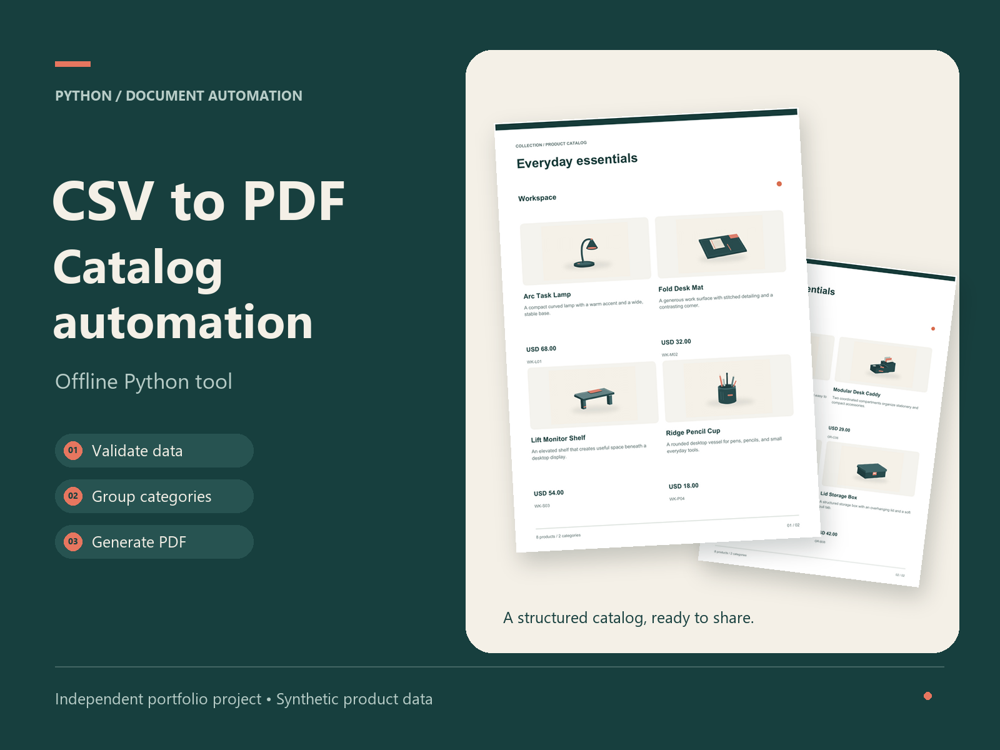

# CSV 自动生成 PDF 商品目录

离线 Python 办公自动化工具，将 CSV 商品表和本地图片生成按分类分页的 PDF 目录。提供图形界面和命令行，包含数据校验、重复 SKU 检查、图片路径限制及文件覆盖保护。



独立开发案例，所有商品与图片均为自制数据，使用 AI 辅助开发并经过测试。未获得原岗位客户委托，也未声称客户验收。

## 使用

需要 Python 3.11 或更新版本及 Tcl/Tk，未打包为免安装 EXE。

```sh
python -m pip install -r 1294_依赖.txt
python 1294_目录工具.py
python 1294_目录工具.py 1294_示例商品.csv --output 新目录.pdf
```

Windows 可双击 `1294_启动界面.pyw`。完整参数、输入字段、限制与来源说明见[使用说明](1294_使用说明.md)。

## 验证

```sh
python -m pip install pypdf
python 1294_验收测试.py
```

23 项行为验收通过：示例页数及全部 SKU/金额、分类分页、中文、501/1001 行批量生成、异常 CSV/金额/图片路径、禁止覆盖及失败清理。GUI 入口做了路由测试，PDF 另经过逐页图片渲染检查。

查看[真实生成的两页示例 PDF](1294_示例目录.pdf)与[验收记录](1294_验收结果.txt)。

每个分类独立起页，每页最多四件商品；过长文字明确拒绝。程序运行时不联网，依赖安装需网络。
